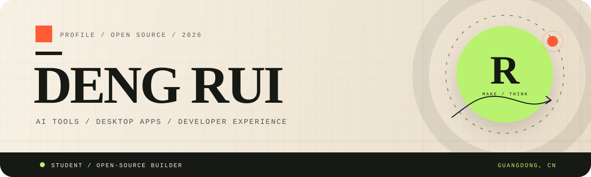
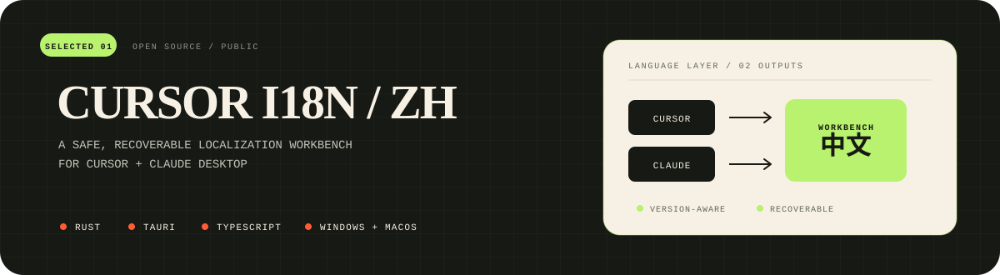

  

 

  <strong>I build AI tools, desktop applications, and developer productivity software.</strong> 
  Student · Open-source builder · Guangdong, China

 

<table>
  <tr>
    <td width="33%" valign="top">
      <strong>BUILD</strong>  
      AI tooling, desktop apps, and workflows that make complex software feel simple.
    </td>
    <td width="33%" valign="top">
      <strong>CRAFT</strong>  
      Local-first systems, careful interfaces, recoverable operations, and clear boundaries.
    </td>
    <td width="33%" valign="top">
      <strong>EXPLORE</strong>  
      Rust, developer experience, agentic tools, and the space between design and engineering.
    </td>
  </tr>
</table>

## 01 / SELECTED WORK

  Safe, recoverable localization for AI desktop apps. Built with Rust, Tauri, and TypeScript.

## 02 / TOOLKIT

  
  
  
  
  

## 03 / NOW

> **Building** localization infrastructure and agent-friendly desktop tools. 
> **Learning** Rust systems, local-first architecture, and interface craft. 
> **Exploring** the overlap between design, engineering, and AI workflows.

  
  
  

## 04 / CONTRIBUTION MAP

  <picture>
    <source media="(prefers-color-scheme: dark)" srcset="https://raw.githubusercontent.com/svipm/svipm/output/github-contribution-grid-snake-dark.svg" />
    <source media="(prefers-color-scheme: light)" srcset="https://raw.githubusercontent.com/svipm/svipm/output/github-contribution-grid-snake.svg" />
    
  </picture>

 

  Designed for clarity. Built with care.

